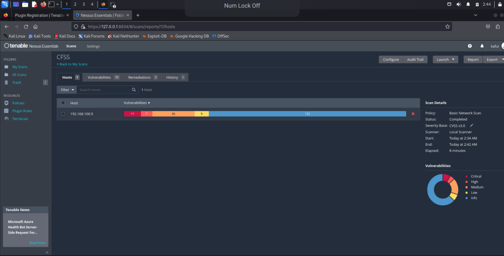
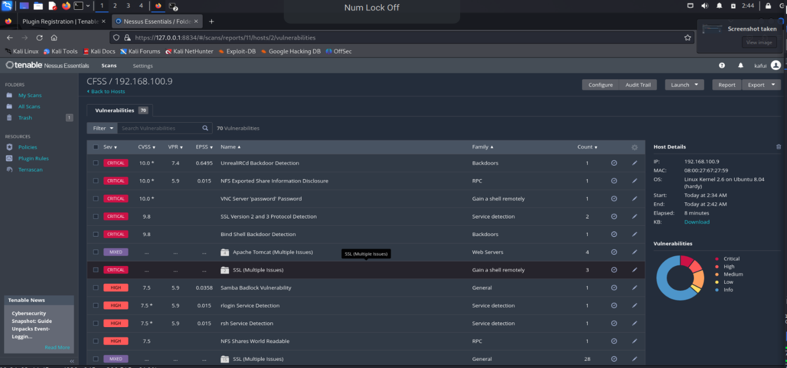
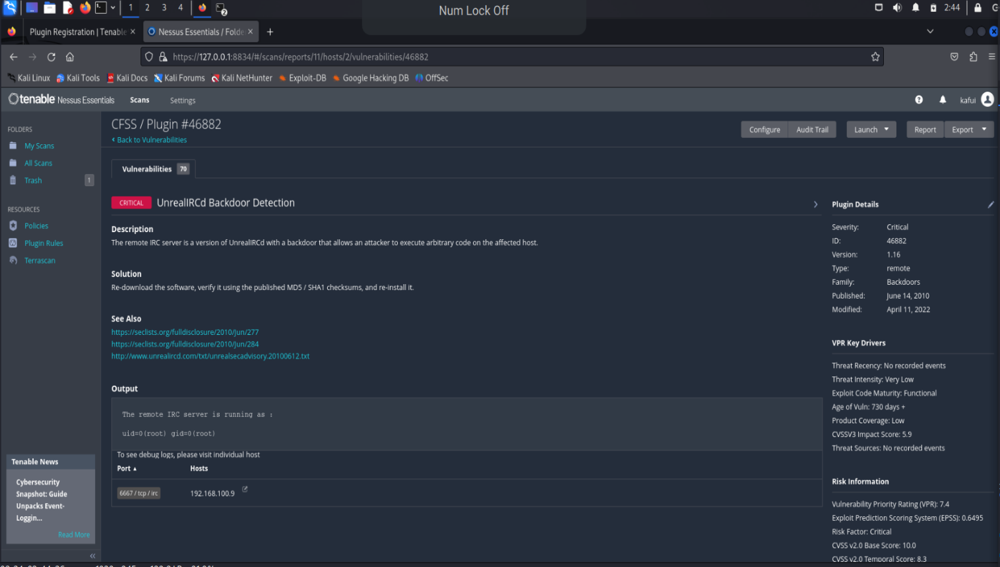
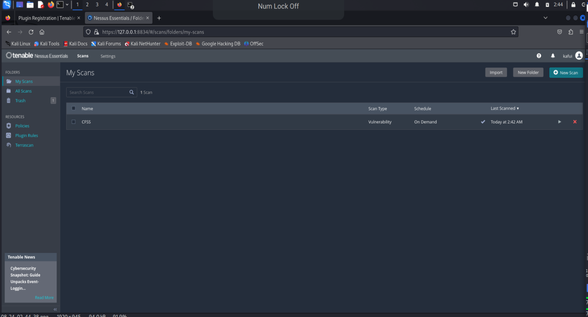
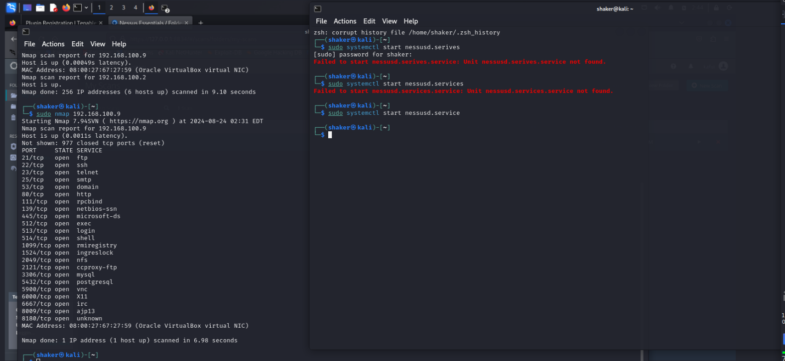

# Lab 01 — Vulnerability scan on a Metasploitable machine using Nessus

Vulnerability scanning is the process of identifying security weaknesses and flaws in
systems and software. Nessus, by Tenable, scans devices, applications, operating
systems and cloud services for known vulnerabilities.

## Setup

1. **Lab:** Kali Linux virtual machine ("learning") running on VirtualBox.
2. **Download:** Nessus for Linux, Debian amd64, from the Tenable website (agree to
   the licence to download).
3. **Verify:** get the SHA-256 checksum from the download page and compare it against
   the downloaded file before installing.
4. **Install:**
   ```bash
   sudo apt install ./Nessus-<version>-debian10_amd64.deb
   ```
5. **Licence:** register for Nessus Essentials (free) on the Tenable site — an
   activation code is emailed to you.
6. **Start the service and open the web UI:**
   ```bash
   sudo systemctl start nessusd.service
   ```
   Then browse to `https://localhost:8834`, accept the certificate warning, and
   complete setup (offline registration with the challenge code and activation code,
   then create an admin username and password).
7. **Plugins:** Nessus downloads its plugin feed on first run. Until that finishes,
   no scan can be created — wait for the download and the 100% CPU plugin compile
   to complete (Settings → Software Update, or just wait).

## Finding the target

The target is a Metasploitable virtual machine on the same lab network. Discover it
with Nmap across the subnet, then confirm the host:

```bash
nmap 192.168.100.0/24
```

Target found: **`192.168.100.9`** (Linux, Kernel 2.6 on Ubuntu 8.04 Hardy).

## The scan

- **Type:** Basic Network Scan
- **Target:** `192.168.100.9`
- **Ports:** all ports (not just well-known)
- **Options:** scan for known web vulnerabilities
- **Duration:** 8 minutes

## Results — 70 vulnerabilities





Critical findings included:

| Finding | Severity | Notes |
|---------|----------|-------|
| UnrealIRCd Backdoor Detection | Critical (CVSS 10.0) | Backdoored IRC server, remote code execution |
| NFS Exported Share Information Disclosure | Critical (CVSS 10.0) | NFS shares exposed |
| VNC Server "password" Password | Critical (CVSS 10.0) | VNC protected by the literal password `password` |
| SSL Version 2 and 3 Protocol Detection | Critical (CVSS 9.8) | Obsolete, broken SSL versions enabled |
| Bind Shell Backdoor Detection | Critical (CVSS 9.8) | Backdoor listening on the host |
| Samba Badlock Vulnerability | High (CVSS 7.5) | |
| rlogin / rsh Service Detection | High (CVSS 7.5) | Cleartext remote login services |
| NFS Shares World Readable | High (CVSS 7.5) | |

Drilling into the UnrealIRCd finding shows the detail Nessus gives per plugin —
description, solution, references, and the raw output proving the issue (the remote
IRC server running as `uid=0(root)`):







## Takeaway

A single unpatched lab machine exposed 70 findings, 11 of them critical — including
two separate backdoors and a VNC server protected by the word "password". That is
what an unpatched, internet-facing host looks like to a scanner: the scan does the
finding, the report does the prioritising, and the fix list writes itself.
