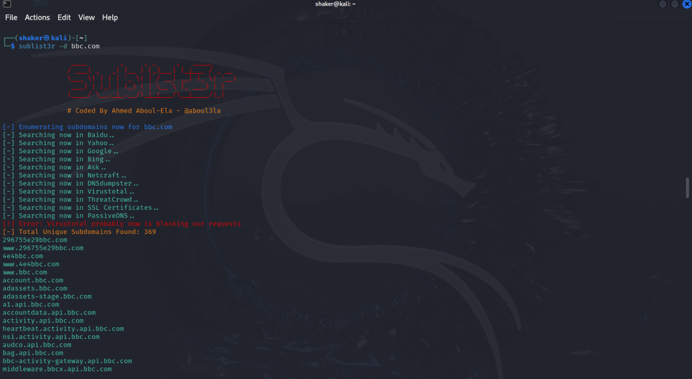
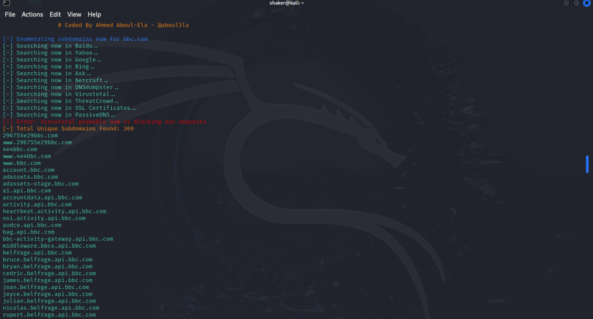
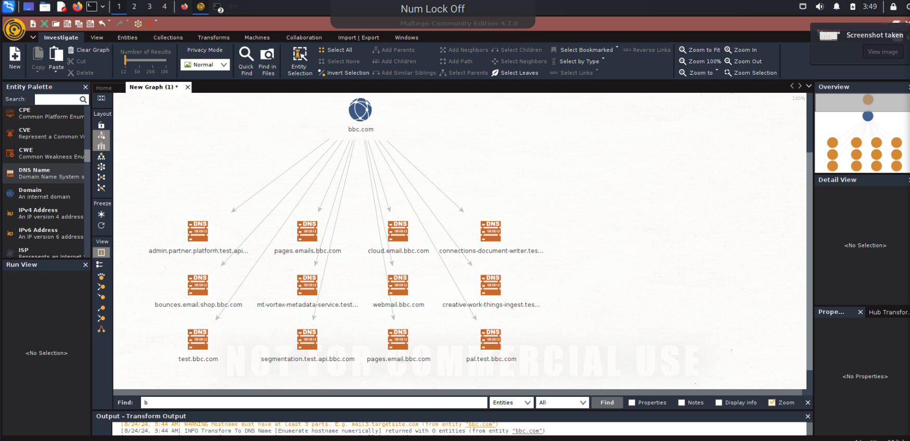
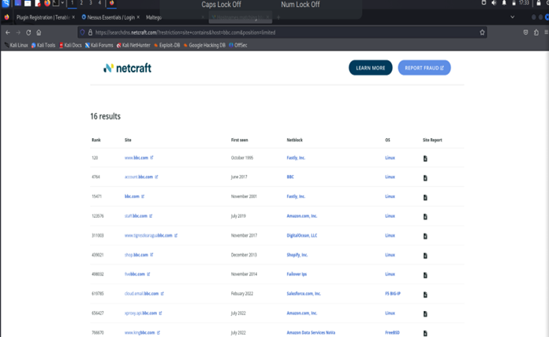

# Lab 02 — Discovering subdomains of a target (bbc.com)

Subdomain enumeration maps the attack surface of a domain before any deeper testing:
every subdomain is a potential entry point. This lab runs the same target through
three different tools and compares what each one finds.

**Target:** `bbc.com` (public reconnaissance only — no active testing against the host).

## Sublist3r

Sublist3r enumerates subdomains using search engines and public sources.

## Maltego

Maltego Community Edition visualises the same data as a graph — the target domain in
the centre, discovered DNS names branching off it. Subdomains found include
`webmail.bbc.com`, `test.bbc.com`, `pages.emails.bbc.com`, `cloud.email.bbc.com`,
`bounces.email.shop.bbc.com` and `segmentation.test.api.bbc.com`.

## Netcraft

Netcraft's site report gives a third, independent view of the domain's footprint —
hosting, technologies and known subdomains.

## Takeaway

One tool gives you a list; three tools give you confidence. Sublist3r is fast and
scriptable, Maltego shows relationships between entities, and Netcraft adds hosting
and technology context. In a real engagement the combined list becomes the scope for
everything that follows.
