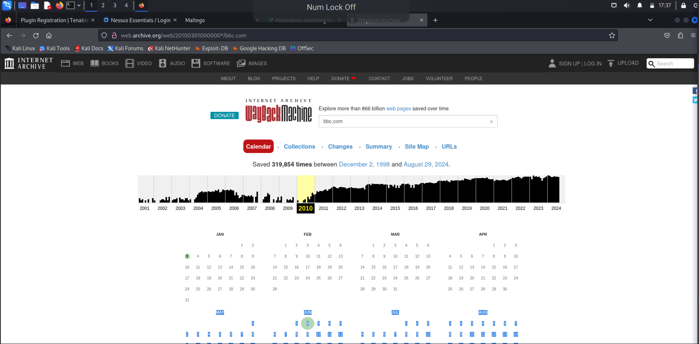
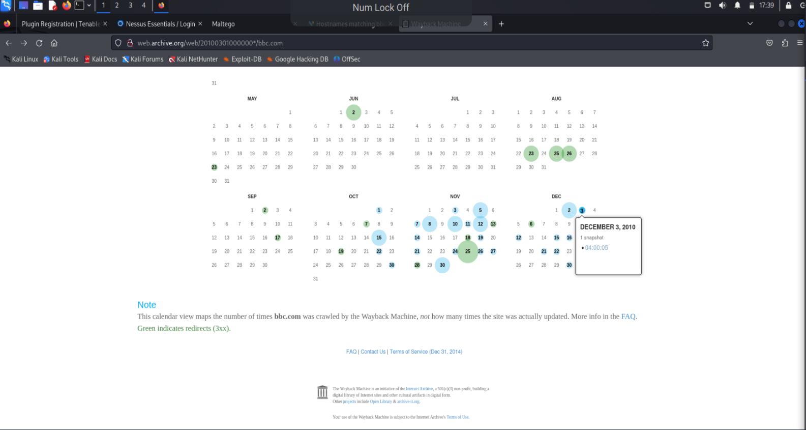
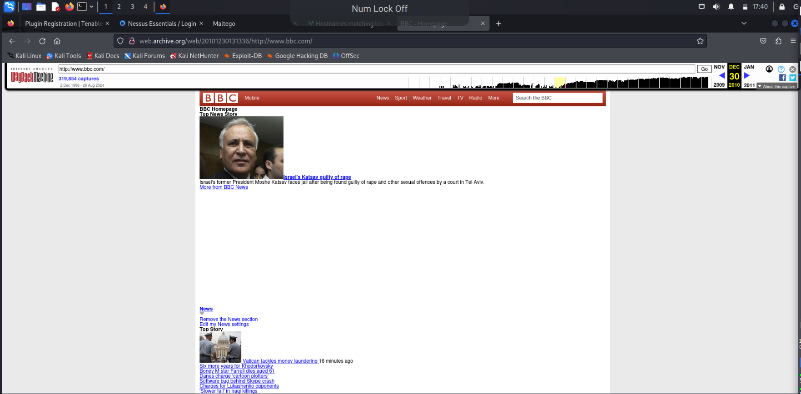

# Lab 03 — Wayback Machine

The Wayback Machine is a digital archive of the World Wide Web, run by the Internet
Archive. Since its launch in 2001, over 728 billion pages have been added to it.

## How to use it

1. Go to [web.archive.org](https://web.archive.org/).
2. Enter the URL of the page you are interested in and hit return.
3. The next screen shows either:
   - a calendar listing the snapshot dates for all archived copies of that page, or
   - a box near the bottom with a link inviting you to save the URL in the Wayback
     Machine.

## Why it matters for security work

Archived pages let you see what a site used to expose: old pages, retired endpoints,
staff names, file paths and technologies a target has since removed. It is entirely
passive reconnaissance — you never touch the live target — and it is often the first
place to look when mapping what an organisation used to run.
