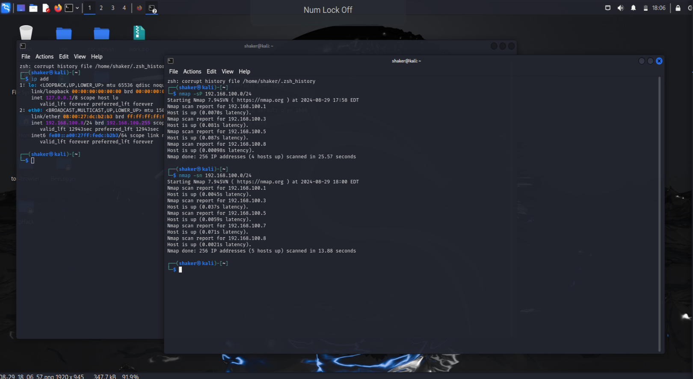

# Lab 04 — Establishing a connection to a local area network via Wi-Fi

Connecting a Kali machine to the lab LAN over Wi-Fi, so the lab target is reachable
for scanning and testing.

> Short write-up — the lab evidence is the screenshot above. The process: select
> the lab network from the Wi-Fi list, authenticate, confirm the machine has an
> address on the lab subnet (`192.168.100.0/24`), and verify connectivity to the
> target before running any scan.
